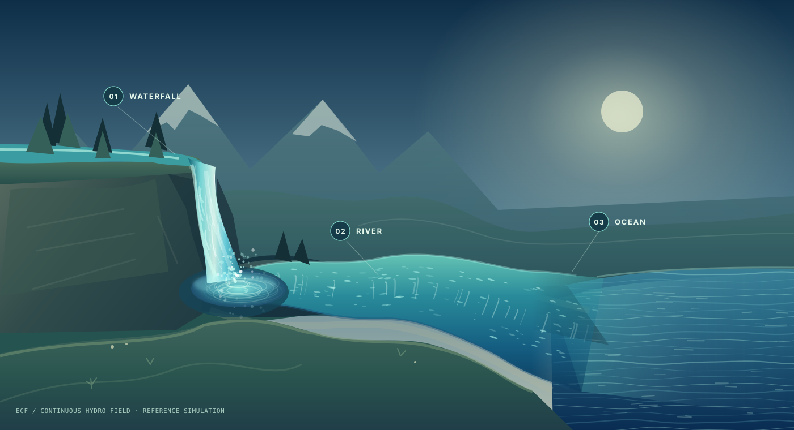

# EveComputeField — Virtual Compute Field Runtime

**Independent repository:** `EveMissLab/EveComputeField`. This project is not the organization website, portfolio index or project catalog.

Date: **2026-10-30 (Asia/Taipei)**  
Project owner: **EVEMISS TECHNOLOGY CO., LTD. / EveMissLab**  
Status: **M3 LOCAL FLUID SVG BENCHMARK — REFERENCE PROTOTYPE, NOT A PRODUCTION RUNTIME**
License: MIT (included in the public repository)

## Purpose / 目的

Create an **offline-first, local-network-oriented, persistent-identity Virtual Compute Field**, in which users can declare logical-unit counts, logical memory domains, dependency-aware computation, and execution placement independently of any one programming language or hardware backend.

The reference implementation uses Go as a **replaceable bootstrap**, not as the permanent authority for field semantics. Future connectors may target NOVA, EML-SF, MACR, ODTS, TCGCT/TCGQT, GMA, or other EveMissLab systems after each coupling contract is individually verified. A connector's existence here does **not** imply completed upstream integration.

**本專案不是：** 新增物理 CPU 核心、跨網路共享任意 RAM 的透明代理、通用虛擬機、實際控制 CPU 每個硬體時脈的工具，亦非已整合 NOVA 等專用研究技術的成品。

## What is implemented now

- JSON `field/v0.1` spec with stable field ID, **1–65,536 reference logical unit slots**, two memory-domain kinds, and task DAG.
- Logical unit IDs remain stable for surviving indexes after quiescent resize in the in-process API.
- Validated DAG, deterministic topological layer plan, bounded concurrent execution per layer, atomic **logical layer commit** and field epoch on successful run.
- Reference pure operators `sum` / `mul` to demonstrate general computation without exposing arbitrary command execution.
- `volatile` and `snapshot` **logical** memory domains, explicit quotas, JSON snapshot save/load. `snapshot` is **not mmap or an OS address space**.
- Local-authority multi-process test path: coordinator uses a remote stateless worker for an intermediate graph node, returns result to local node.
- TLS 1.3 mutual-certificate authentication for worker network exposure; no anonymous LAN mode.
- Go unit tests, mTLS tests, Windows-compatible source, ready-to-run CLI examples.

## M1 — Persistent field authority (loopback local service)

**M1 is now implemented**: a local daemon can hold several fields, serve
repeated calls, checkpoint field state, and restore it after a graceful process
restart. New control endpoints are **loopback-only** with a high-entropy token.
For exact endpoints, limits, security and recovery semantics, read
[docs/M1_FIELD_AUTHORITY.md](docs/M1_FIELD_AUTHORITY.md).

Terminal A (create a local-only 256-bit token **once**, then start the daemon):

```bash
go run ./cmd/evefield token -out ./control.token
go run ./cmd/evefield serve -data ./field-data -token-file ./control.token
```

Terminal B:

```bash
go run ./cmd/evefield ctl create -spec examples/local.json
go run ./cmd/evefield ctl list
go run ./cmd/evefield ctl run -id reference-local
go run ./cmd/evefield ctl inspect -id reference-local
go run ./cmd/evefield ctl put -id reference-local -domain continuity -key greeting -value hello
go run ./cmd/evefield ctl get -id reference-local -domain continuity -key greeting
```

Stop and restart Terminal A: `inspect` still reports the previously committed
`epoch` and `results`, and the `continuity` key still exists. This is **durable
field identity and stored state**, not a claim that tasks keep executing after
machine shutdown. Use only one `serve` per data directory; a stale lock after
an unclean crash must be investigated before manual removal.

## M2 — Local-first application invocation (new)

**Use one local computer first. No cloud, Dot, Grok or LAN is required for the M2 workflow.**
M2 adds journal-recoverable logical-unit resizing, an **opt-in local named-workload
registry**, a standard-input/stdout process adapter, `ctl status`, `ctl resize`,
`ctl workloads`, `ctl invoke` and a Windows PowerShell startup script. The
workload registry allows users to invoke explicitly configured trusted programs
as field-associated tasks; these are **not sandboxed** and their side effects
are **not** rolled back by field snapshots. Existing DAG operations are still
pure `sum`/`mul` and remain independent of this adapter.

On Windows, at the repository root in PowerShell A:

```powershell
powershell -ExecutionPolicy Bypass -File .\scripts\start-local.ps1
```

The script compiles a local executable, creates a private token and example
workload registry (without overwriting existing ones), and starts a loopback
service. In PowerShell B:

```powershell
$exe = '.\build\evefield.exe'
$token = '.\.evefield-local\control.token'
& $exe ctl status -token-file $token
& $exe ctl create -spec examples/local.json -token-file $token
& $exe ctl resize -id reference-local -units 720 -token-file $token
& $exe ctl invoke -id reference-local -workload hash -input-file examples/invoke.txt -save-domain continuity -save-key last_hash -token-file $token
& $exe ctl get -id reference-local -domain continuity -key last_hash -token-file $token
```

See **[M2 local-first guide](docs/M2_LOCAL_FIRST.md)** for full details,
Linux setup, registry JSON, failure semantics and validation status. `ctl
create` is only necessary once per field identity.

## M3 — SVG fluid-field challenge (new)

**瀑布 → 河流 → 河口 → 海洋，在同一個 SVG 場景。**



Open **[`examples/fluid/index.html`](examples/fluid/index.html)** locally to
interactively control a continuous SVG-only drawing. The scene uses a
conservative 96-cell 1D shallow-water river solver, with the waterfall as the
upstream discharge source and ocean as downstream tidal-stage boundary.
All visible geometry is SVG; the external controls are HTML. No Canvas,
WebGL, CDN or cloud service is used. Included is an exported static
[`scene.svg`](examples/fluid/scene.svg).

The independent **Go** implementation is a real field-associated workload:

```bash
go run ./cmd/evefield tool fluid < examples/fluid/scenario.json
node --test examples/fluid/fluid.test.js
bash scripts/smoke-m3-fluid-linux.sh
```

Read [M3 fluid benchmark & physical-model limitations](docs/M3_FLUID_SVG_BENCHMARK.md)
for numerical assumptions, conservation, local Windows execution, persistent
field invocation and what is *not* physically solved.

## Quick start — original one-shot CLI

Prerequisite: Go **1.23+** (reference code is compiled/tested with 1.23; install a maintained security-patched version in practice). No third-party Go module dependencies.

```bash
go test ./...
go run ./cmd/evefield plan -spec examples/local.json
go run ./cmd/evefield run -spec examples/local.json -state ./field-state.json
```

Local example should produce:

- `seed-a = 5`, `seed-b = 20`, `combine = 26`, `output = 52`.
- Repeating a run against the same `-state` path advances the **field epoch**; the file preserves the field's continuity record but does not keep a CPU actively running between invocations.

### LAN demonstration (two terminals, one host to begin with)

Development certificates are self-signed and expire after seven days. Never commit `dev-certs` and never use these demo credentials on an untrusted network.

```bash
# One-time temporary development certificates
go run ./cmd/evefield certs -out ./dev-certs -host 127.0.0.1

# Terminal A: worker (TLS 1.3 + mandatory client certificate)
go run ./cmd/evefield worker -listen 127.0.0.1:8443 -ca ./dev-certs/ca.crt -cert ./dev-certs/worker.crt -key ./dev-certs/worker.key

# Terminal B: coordinator dispatches a DAG node to the worker
go run ./cmd/evefield run -spec examples/lan.json -state ./lan-state.json -remote worker=https://127.0.0.1:8443 -ca ./dev-certs/ca.crt -cert ./dev-certs/client.crt -key ./dev-certs/client.key
```

Expected DAG: `local-seed=5 → remote-multiply=10 → local-result=11`.

To test **two machines in a trusted LAN**, regenerate the worker certificate with `-host` equal to its actual LAN address or DNS name, set the worker `-listen` address appropriately, install certificate material securely, use a host firewall allowlist, and change the `-remote` URL. The worker does not auto-enroll or discover peers. The `ca.key` must stay offline from workers and clients.

Windows PowerShell: use the same `go run ./cmd/evefield ...` commands, with separate PowerShell terminals. Certificates and snapshot paths are relative to the repository directory. Do not run commands from an untrusted source.

## Repository layout

```text
cmd/evefield/           CLI: plan, run, worker, certs, token, serve, ctl, tool
internal/field/         Field schema, DAG, pure reference backend, state snapshots
internal/authority/     Single-writer persistent field registry + resize recovery
internal/control/       Authenticated loopback control API + M2 invocation
internal/workload/      Named, bounded, opt-in local process invocation (not sandbox)
internal/transport/     Strict JSON + mTLS worker client/server (legacy optional)
internal/devcert/       Development certificates only
examples/               Minimal local and LAN specs
docs/                   Detailed contracts, scope, release gate, repository decisions
```

## Core design boundary

```text
Application / human / AI caller (future SDK)
                 |
    Field public semantic contract v0.1
                 |
 Field lifecycle + logical units + memory domains
                 |
   Dependency plan + commit / replay evidence
                 |
     Backend interfaces (replaceable)
         /                    \
   Local Go reference     Local named workloads (opt-in)
                      [remote mTLS worker: optional pre-existing capability]
     [optional later: NOVA / EML-SF / ODTS / MACR / TCGCT / GMA]
```

**The controller owns the field identity and state. A remote worker owns only the execution of a requested pure task.** Physical cores, goroutines, logical units, and field identities are not interchangeable quantities.

For public claims and limitations, see [TECHNICAL_BASELINE](docs/TECHNICAL_BASELINE.md), [INTERFACE_CONTRACTS](docs/INTERFACE_CONTRACTS.md), [SECURITY](SECURITY.md), and [RELEASE_GATE](docs/RELEASE_GATE.md).

This is a separate core-systems project: **the organization website and `evemisslab-project-catalog` are not execution dependencies.**

## Module identity and repository

The Go module is `github.com/EveMissLab/EveComputeField`; its CLI entry point is `./cmd/evefield`. The independent public repository is [EveMissLab/EveComputeField](https://github.com/EveMissLab/EveComputeField). The field authority and application runtime remain separate from the organization website and project catalog.

## Open-source position

Only self-contained, independently authored public-safe reference code and public architecture have been packaged. The private or experimental upstream systems are not copied or released here. MIT is included for the reference implementation; a future proprietary adapter can remain separate without changing the open core. All future private or non-public research adapters require a separate explicit publication review; do not assume their source is included.

### Historical manifests

`MANIFEST_SHA256.txt` is the immutable-file list from the prior bootstrap
reference package. It is **not** a verification manifest of M2; use
`MANIFEST_SHA256_M2.txt` for this revision's tracked source snapshot.
