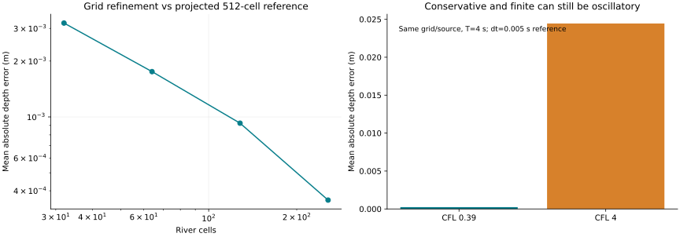
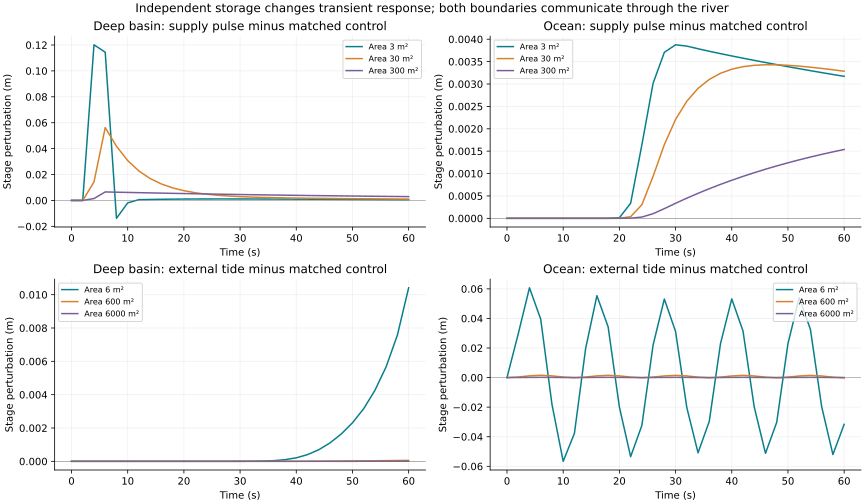
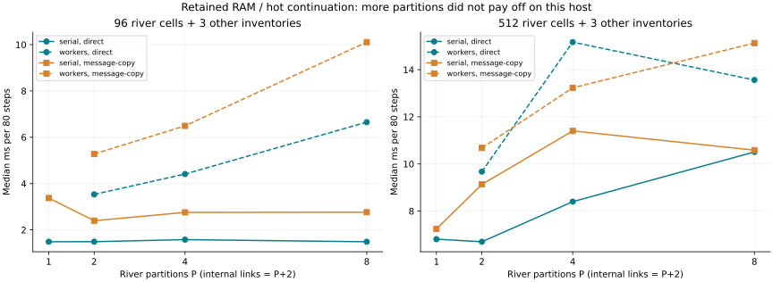
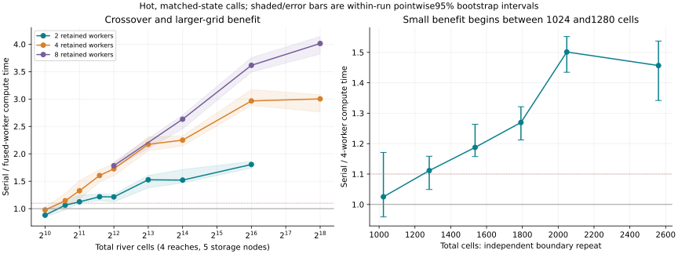
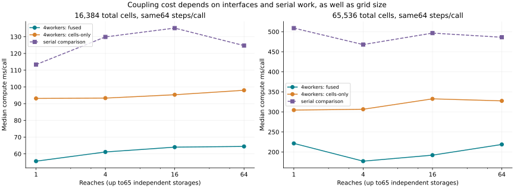
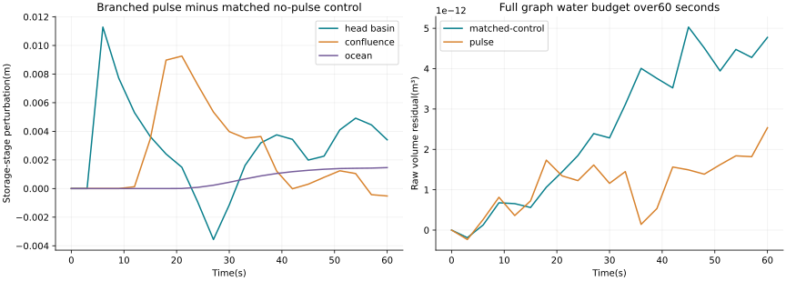

# M3 R1–R3 measured results

Measured2026-10-31 on Windows x64, AMD Ryzen7 2700X/16 logical CPUs,
Node24.16.0 and Go1.27.3. These are synthetic reduced models and bounded
single-host experiments, without natural-site calibration or production SLA.
Baseline: `471ae0b58b8c7a439fdd4ceceb6ca8fd538b265c`.

[Public evidence](evidence/README.md) preserves numerical samples/configurations
with control identifiers and private operational context removed. Delivered
file hashes describe that derivation. Portability wrappers were improved after
measurement; historical timings are not new timings of those wrappers.

## R1 — resident computation

R1 reproduces the original unit-width1D river. The waterfall is an upstream
ghost state and the ocean a tailwater boundary; declared inlet discharge need
not equal accepted numerical mass flux. A conserved river budget alone does
not establish full waterfall/ocean continuity.

- 28 Go/JS configurations,51 stability cases with4 retained numerical refusals,
 and42 partition trials plus14 warm-ups.
- Maximum ordinary float64 residual: `1.6342482922482304e-13 m²`.
- f32-state raw residual: `0.00013557407577491354 m²`; arithmetic remains double.
- At8s, nominal supply8m² versus accepted inlet integral about8.1561m².

One20-call continuation trajectory per mode,80 steps/call,96 cells,4 workers:

| Mode | Median ms/call | p95 ms/call |
|---|---:|---:|
| New process, save each call |197.2183|209.7449|
| Resident RAM, save at end |12.6415|15.1488|
| Resident, save each call |14.4741|16.1603|

Final numerical checkpoints match. The comparison includes lifecycle, HTTP,
serialization and persistence, rather than isolated solver speedup. Association
race hardening followed without a latency remeasurement. Small-grid per-step
barrier costs still exceed worker benefit.

## R2 — four independent inventories

R2 couples fixed-delay waterfall inventory, constant-area deep basin,1D river
and finite ocean storage. Volumes use m³ with explicit river width. Each link
has one accepted signed transfer shared by both regions; all proposals are
audited before physical commit.

- 17 tests passed at measurement;54 cases complete51 and retain3 refusals:
 near-dry export, unsafe fixed step and a deliberately broken ledger.
- Maximum recorded float64 raw residual, including60s responses:
 `4.851585799769964e-11 m³`.
- f32-state raw drift `0.0005289328520401426 m³`; separately quantization-corrected
 residual `2.632116746781321e-12 m³`. This is not full single-precision arithmetic.
- Sloped-bed lake-at-rest and flat frictionless uniform-flow fixtures pass.
 Grid/time refinement reduces error against a numerical reference.

CFL4 stays finite/conservative yet produces24.447mm mean depth error and6.874m
total depth variation; the CFL.39 comparison gives.236mm and.720m. Conservation
does not establish absence of numerical oscillation.

Paired no-pulse controls isolate forcing from initial transients. An extra2m³
supply pulse gives peak basin-stage perturbations120.146/56.228/6.556mm for
areas3/30/300m². Larger storage lowers peaks and delays release; the disturbance
subsequently changes ocean storage.

28 organization configurations/280 hot calls have identical matched physical
checkpoint hashes. On96/512 cells workers remain slower. Face assembly, global
timestep and ordered audit are serial; only cell updates are parallel.

## R3 — branched network crossover

R3 separately reaches262,144 cells and64 reaches/65 independent storage nodes/
57 waterfalls. Confluences are finite level-pool storages, conserving volume
without resolving tributary-angle momentum/energy mixing. Node proposals sum
all signed incident flows once, with one common accepted timestep.

Fixed256-cell tiles define worker-independent reduction order. Double banks
prevent rejected proposals changing active state. `fused` parallelizes faces
and updates with two barriers/step; `cells-only` keeps face work serial. Both
arms retain regional/global conservation and wet-storage checks.

972 matched-state pairs/1944 timed calls alternate arm order and reuse pools.
All paired final physical hashes match. Reset, hashing, startup and saving are
outside solver-only timing. Sizes were adaptively probed; intervals below are
pointwise, single-host descriptions, not simultaneous inference or a universal
threshold.

Four reaches/five storages,4 workers,64 steps/call; independent boundary repeat:

| Cells | Geometric median speedup | Pointwise95% interval |
|---:|---:|---|
|1024|1.025×|.959–1.171|
|1280|1.111×|1.049–1.159|
|1536|1.188×|1.157–1.264|
|1792|1.270×|1.212–1.321|
|2048|1.501×|1.435–1.552|
|2560|1.457×|1.342–1.537|

The recorded operational rule was median≥1.10, interval lower>1 and both block
medians>1; that is not95% confidence of at least10% benefit.1280 cells show
marginal observed benefit;1536 has a pointwise lower bound above1.10. About2048
provides more practical margin on this host.

| Cells | Workers | Median speedup | Pointwise95% interval | Steps/call |
|---:|---:|---:|---|---:|
|65536|2|1.806×|1.740–1.863|64|
|65536|4|2.965×|2.881–3.172|64|
|65536|8|3.615×|3.492–3.756|64|
|262144|4|3.003×|2.763–3.079|16|
|262144|8|4.014×|3.821–4.140|16|

At16,384 total cells/64 steps, reaches1→64 raise physical endpoint/waterfall
links3→185 and4-worker fused median55.627→64.430ms. This supports interface/
coordination cost, without a strict monotonic or general complexity law.
Cells-only is slower. Message-copy measures local structured-clone packaging,
not network RPC. Different grids' step counts cover different simulated times;
speedup comparisons stay within matched grids/graphs.

16 R3 tests passed at measurement.29 stability cases complete25 and retain4
bounded refusals: one explicit step-budget cap at a tiny junction, near-dry
storage, broken node debit and unsafe fixed step. Maximum recorded float64 raw
residual is `5.030642569181509e-12 m³`; f32-state raw drift
`0.0003328037273151452 m³`, with separately corrected residual
`2.7796515089661966e-12 m³`.

The262,144-cell stability case covers128 steps. Separate768-cell pulse/control
networks reach60 simulated seconds; this is not60s high-resolution evidence.
CFL4 remains finite/conservative but has30.979mm mean depth error and22.359m
total variation, versus.802m for the small-step reference.

A local output-file error interrupted the coupling study after38 saved rows;
completed rows were reused and only unfinished configurations repeated. Atomic
result writes/resume and a backing-buffer assertion followed outside advance
timing. Physics and the timed solver protocol stayed unchanged.

## State custody, SVG and limits

R2/R3 explicit save/restart/continuation/reorganization matches uninterrupted
references. R3's65536-cell h/q arrays occupy1MiB in verified local CAS blobs,
with a small Go M2 manifest. These have distinct custody; there is no public
authenticated-identity certificate or complete power-loss guarantee.

SVG desktop/mobile views match backend state. R3's65536-cell view displays1024
interval averages without reducing solver resolution; aggregate volume matches
full-grid storage. Canvas/WebGL calls are zero. This is a schematic and not an
isolated GPU/FPS measurement.

There is no idle eviction, simulation schedule, automatic restart or provider
dispatch. Trusted local adapters are not a sandbox; logical field units are
not hardware workers. These reduced models do not validate3D impact, wet/dry
fronts, ocean waves, junction-angle mixing or natural-site accuracy.
